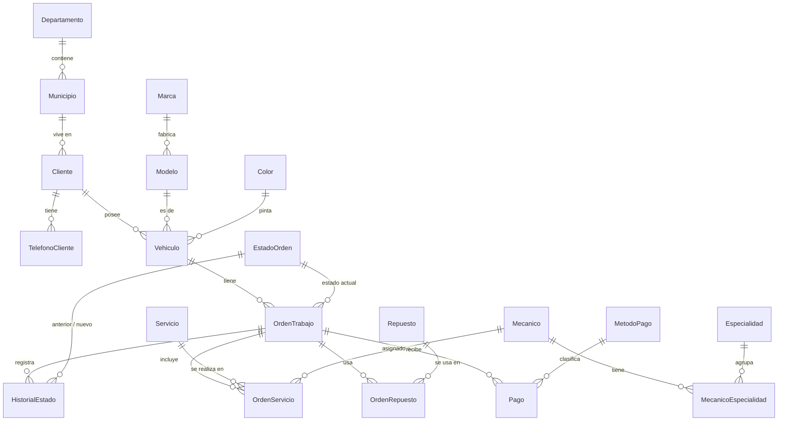

# Documentación técnica

## 1. Arquitectura
Navegador (HTML/CSS/JS) → Django (`core/views.py`) → `core/db.py` → SQL Server (tablas, vistas, funciones, procedimientos).

Las reglas de negocio críticas viven en SQL Server (procedimientos con transacción) para que se cumplan
aunque alguien acceda a la base desde otro sistema. Django valida formatos y muestra los mensajes que
lanzan los procedimientos con `THROW`.

## 2. Diagrama entidad-relación
Se puede pegar en https://mermaid.live para exportarlo como imagen.



## 3. Modelo relacional (20 tablas)
**Ubicación**
- **Departamento**(IdDepartamento PK, Nombre UNIQUE)
- **Municipio**(IdMunicipio PK, IdDepartamento FK, Nombre) — UNIQUE(IdDepartamento, Nombre)

**Clientes**
- **Cliente**(IdCliente PK, Nombres, Apellidos, NIT, Correo, Calle, Zona, IdMunicipio FK, FechaRegistro, *Nombre calculado*)
- **TelefonoCliente**(IdTelefono PK, IdCliente FK, Numero, Tipo, Principal) — UNIQUE(IdCliente, Numero)

**Vehículos**
- **Marca**(IdMarca PK, Nombre UNIQUE)
- **Modelo**(IdModelo PK, IdMarca FK, Nombre) — UNIQUE(IdMarca, Nombre)
- **Color**(IdColor PK, Nombre UNIQUE)
- **Vehiculo**(IdVehiculo PK, IdCliente FK, Placa UNIQUE, IdModelo FK, Anio, IdColor FK, VIN, Kilometraje)

**Mecánicos**
- **Mecanico**(IdMecanico PK, Nombres, Apellidos, Telefono, TarifaHora, Activo, *Nombre calculado*)
- **Especialidad**(IdEspecialidad PK, Nombre)
- **MecanicoEspecialidad**(IdMecanico PK/FK, IdEspecialidad PK/FK)

**Órdenes**
- **EstadoOrden**(IdEstado PK, Nombre, Secuencia)
- **OrdenTrabajo**(IdOrden PK, IdVehiculo FK, IdEstado FK, FechaIngreso, KmIngreso, FallaReportada, Diagnostico, Observaciones, Descuento, FechaEntrega)
- **HistorialEstado**(IdHistorial PK, IdOrden FK, EstadoAnterior FK, EstadoNuevo FK, FechaCambio, Usuario, Comentario)
- **Servicio**(IdServicio PK, Nombre, Descripcion, PrecioBase, Activo)
- **OrdenServicio**(IdOrdenServicio PK, IdOrden FK, IdServicio FK, IdMecanico FK, Precio, HorasManoObra, TarifaHora)
- **Repuesto**(IdRepuesto PK, Codigo UNIQUE, Nombre, Precio, Stock, StockMinimo)
- **OrdenRepuesto**(IdOrdenRepuesto PK, IdOrden FK, IdRepuesto FK, Cantidad, PrecioUnitario)
- **MetodoPago**(IdMetodoPago PK, Nombre)
- **Pago**(IdPago PK, IdOrden FK, IdMetodoPago FK, Monto, FechaPago, Referencia)

### Normalización
- **1FN (atributos atómicos):**
  - El nombre se guarda separado en **Nombres** y **Apellidos** (se puede ordenar y buscar por apellido).
  - La dirección se guarda en partes: **Calle**, **Zona** y **Municipio** (y por él, el Departamento). Así se puede filtrar, por ejemplo, "clientes de Mixco" o "de zona 12".
  - Los **teléfonos** van en su propia tabla: un cliente puede tener varios sin columnas Telefono1, Telefono2… ni listas separadas por comas.
  - Los teléfonos se guardan **solo con dígitos** (CHECK), sin guiones ni espacios.
  - Las especialidades de un mecánico van en filas aparte (MecanicoEspecialidad).
- **2FN:** las tablas con PK compuesta (MecanicoEspecialidad) no tienen atributos que dependan de solo una parte.
- **3FN (sin dependencias transitivas):**
  - Antes, en Vehiculo, la **marca dependía del modelo** (Corolla → Toyota). Ahora Vehiculo solo guarda IdModelo y la marca está en Modelo.
  - El **departamento depende del municipio**, por eso el cliente solo guarda IdMunicipio.
  - Marca, modelo, color, estados y métodos de pago son catálogos: se evita escribir "toyota", "Toyota" y "TOYOTA" como si fueran distintos.
- **Columnas calculadas:** `Cliente.Nombre` y `Mecanico.Nombre` se arman con `CONCAT(Nombres, Apellidos)` al consultar; **no se almacenan**, así que no rompen la atomicidad ni generan redundancia.
- **Vistas de presentación:** `vw_Cliente` y `vw_Vehiculo` vuelven a juntar los datos (dirección completa, teléfono principal, "Toyota Corolla") solo para mostrarlos.
- **Desnormalización intencional:** `OrdenServicio.Precio`, `OrdenServicio.TarifaHora` y `OrdenRepuesto.PrecioUnitario`
  copian el precio vigente para conservar lo que se cobró aunque después cambie el precio.
- El **total no se guarda**: se calcula con `fn_TotalOrden`.

## 4. Reglas de negocio (dónde se validan)
| Regla | Implementación |
|---|---|
| Placa única, solo letras y números | `UQ_Vehiculo_Placa`, `CK_Vehiculo_Placa` |
| Teléfono solo dígitos (8 a 15) | `CK_Tel_Numero` |
| Un solo teléfono principal por cliente | índice único filtrado `UX_Tel_Principal` |
| El cliente no puede quedarse sin teléfono | `sp_EliminarTelefonoCliente` |
| Zona entre 1 y 25; correo con formato válido | `CK_Cliente_Zona`, `CK_Cliente_Correo` |
| Un vehículo no puede tener dos órdenes abiertas | `sp_CrearOrden` |
| El kilometraje no puede bajar | `sp_CrearOrden` |
| Los estados avanzan de uno en uno; solo se cancela antes de Terminado | `sp_CambiarEstadoOrden` |
| No se pasa a Reparación sin diagnóstico y sin servicios | `sp_CambiarEstadoOrden` |
| No se entrega con saldo pendiente | `sp_CambiarEstadoOrden` |
| Cada cambio queda en el historial con usuario y fecha | `sp_CrearOrden`, `sp_CambiarEstadoOrden` |
| No hay repuestos sin stock | `sp_AgregarRepuestoOrden` (UPDLOCK + ROLLBACK) |
| Cancelar devuelve los repuestos al inventario | `sp_CambiarEstadoOrden` |
| No se paga más que el saldo; tarjeta/transferencia exige referencia | `sp_RegistrarPago` |
| Montos y cantidades no negativos | restricciones `CHECK` |

## 5. Procedimientos almacenados
| Procedimiento | Uso en la app | Tablas afectadas |
|---|---|---|
| sp_RegistrarClienteVehiculo | Nuevo cliente | Cliente, TelefonoCliente, Vehiculo |
| sp_AgregarTelefonoCliente | Agregar teléfono | TelefonoCliente |
| sp_MarcarTelefonoPrincipal | Hacer principal | TelefonoCliente (transacción) |
| sp_EliminarTelefonoCliente | Eliminar teléfono | TelefonoCliente (transacción) |
| sp_CrearOrden | Nueva orden | OrdenTrabajo, HistorialEstado, Vehiculo |
| sp_CambiarEstadoOrden | Botones de estado | OrdenTrabajo, HistorialEstado, Repuesto |
| sp_AgregarServicioOrden | Asignar servicio y mecánico | OrdenServicio |
| sp_AgregarRepuestoOrden | Agregar repuesto | OrdenRepuesto, Repuesto |
| sp_RegistrarPago | Registrar pago | Pago |
| sp_ActualizarDiagnostico | Guardar diagnóstico | OrdenTrabajo |
| sp_HistorialVehiculo | Historial por vehículo | (consulta) |
| sp_ReporteIngresos | Reporte 1 | (consulta) |

## 6. Cómo funciona una transacción (para la defensa)
```sql
BEGIN TRY
    BEGIN TRAN;                -- inicia
        -- validaciones con THROW (si fallan, salta al CATCH)
        -- UPDATE / INSERT en varias tablas
    COMMIT;                    -- todo salió bien: se confirma
END TRY
BEGIN CATCH
    IF @@TRANCOUNT > 0 ROLLBACK;   -- algo falló: se deshace TODO
    THROW;                          -- se reenvía el error a Django
END CATCH
```
`WITH (UPDLOCK)` bloquea la fila leída para que dos usuarios no tomen el mismo stock al mismo tiempo.
